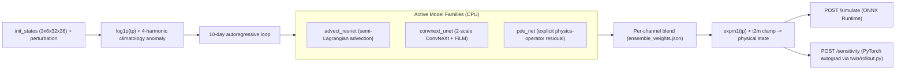

# Multiverse of Monsoon — Climate Digital Twin

**Multiverse of Monsoon** is a physics-aware spatiotemporal Deep Learning Digital Twin for India weather (`Yugaantar DevForge Track 2`).

---

## 1. Introduction

This system simulates 10-day weather rollouts and counterfactual perturbations over India. It also computes differentiable adjoint sensitivity maps and 1-step reverse shocks.

### Domain Specification

| Parameter | Value |
| :--- | :--- |
| Spatial grid | `32 × 36` at `1°` resolution (`6.5°N–37.5°N`, `66.5°E–101.5°E`) |
| Input history | `3` consecutive days (`t-2`, `t-1`, `t`) |
| Forecast horizon | `10` days |
| Output channels (`6`) | `t2m` (K), `tp` (mm/day), `u10` (m/s), `v10` (m/s), `msl` (Pa), `tcwv` (kg/m²) |

### Core Capabilities

- **Forward Counterfactual Server (`POST /simulate`):** Runs a deterministic ONNX Runtime ensemble on CPU in under `0.7s`.
- **Adjoint Sensitivity & Reverse Shock (`POST /sensitivity`):** Backpropagates through the PyTorch rollout to find precursor cells and optimal bounded perturbations.
- **Interactive Dashboard (`dashboard/`):** Displays forecast maps, shock deltas, and click-to-pick adjoint butterfly overlays.

---

## 2. Setup and Deployment

### Prerequisites

- Python `3.12`
- `git` and `git-lfs`
- Node.js `18+` (required for the dashboard only)

### Clone Repository and Weights

1. Clone the repository:
   ```bash
   git clone https://github.com/SinisterDeveloper/twin.git
   cd twin
   ```
2. Pull the Git LFS model weights (`artifacts/*.onnx` and `artifacts/pt/*.pt`):
   ```bash
   git lfs install
   git lfs pull
   ```

### Deploy Backend Server (Offline Track #2 Sandbox)

The server requires no internet access and no runtime downloads.

1. Install Python dependencies (skip this step in the preinstalled Track #2 sandbox):
   ```bash
   pip install -r requirements.txt
   ```
2. Start the FastAPI server on port `8000`:
   ```bash
   python serve.py --port 8000
   ```

> [!NOTE]
> `serve.py` loads only the ONNX models at startup (`~130 MB` RSS). PyTorch checkpoints in `artifacts/pt/` lazy-load on `/sensitivity` or `/sensitivity/warmup`.

### Deploy Frontend Dashboard

1. Open the `dashboard` directory:
   ```bash
   cd dashboard
   ```
2. Install Node packages:
   ```bash
   npm install
   ```
3. Start the development server on `http://localhost:5173` (proxies `/api/*` to `http://127.0.0.1:8000`):
   ```bash
   npm run dev
   ```
4. Build static production assets into `dashboard/dist/` (optional):
   ```bash
   npm run build
   ```

---

## 3. API Reference

All endpoints accept and return `application/json`.

### `POST /health`

Checks server readiness and reports the active ensemble identifier.

- **Request body:** `{}` (empty JSON object)
- **Response (`200 OK`):**
  ```json
  {
    "status": "ready",
    "model_name": "monsoon-twin-ensemble(advect_resnet+convnext_unet+local_swin+pde_net)"
  }
  ```

### `POST /simulate`

Runs an autoregressive rollout from `3` initial days with an optional initial-state perturbation.

- **Request fields:**
  - `init_states` (`float[3][6][32][36]`): Initial 3-day state history.
  - `doy_sincos` (`float[2]`): `[sin(2π · doy / 365), cos(2π · doy / 365)]`.
  - `steps` (`int`): Number of forecast days (default `10`).
  - `perturbation` (`float[6][32][36] | null`): Optional shock added to the latest initial day.
- **Response (`200 OK`):**
  - `rollout` (`float[steps][6][32][36]`): Predicted weather states.
  - `inference_ms` (`float`): Server inference time in milliseconds.

### `POST /sensitivity/warmup`

Pre-loads the PyTorch checkpoints (`artifacts/pt/*.pt`) into CPU memory. The dashboard calls this endpoint on page visit.

- **Request body:** `{}`
- **Response (`200 OK`):**
  ```json
  {
    "status": "ready",
    "models": ["advect_resnet", "convnext_unet", "pde_net"],
    "load_ms": 1701.8
  }
  ```
- **Error (`503`):** Returned if PyTorch or checkpoint files are unavailable.

### `POST /sensitivity`

Computes the adjoint sensitivity map (`∂target / ∂init_states`), a 1-step projected reverse shock, and physics self-checks.

- **Request fields:**
  - `init_states` (`float[3][6][32][36]`): Initial 3-day state history.
  - `doy_sincos` (`float[2]`): Day-of-year sine and cosine pair.
  - `target_day` (`int`): Target rollout day (`1` to `10`).
  - `target_channel` (`string | int`): Channel name (`t2m`, `tp`, `u10`, `v10`, `msl`, `tcwv`) or index.
  - `region` (`object`): Point (`{"type": "point", "lat": 10.5, "lon": 76.5, "radius_cells": 1}`) or box region.
  - `direction` (`"increase" | "decrease"`, optional): Optimization direction (default `"increase"`).
  - `threshold` (`float | null`, optional): Target threshold value.
  - `caps` (`object | null`, optional): Per-channel perturbation magnitude limits.
  - `allowed_channels` (`string[] | null`, optional): Subset of channels allowed for reverse shock.
- **Response (`200 OK`):**
  - `target`: Resolved center coordinates, channel, day, and spatial mask.
  - `butterfly_map` (`float[32][36]`): Non-negative L2 sensitivity magnitude per grid cell.
  - `sensitivity_signed` (`float[6][32][36]`): Signed standardized gradient per channel and cell.
  - `channel_importance` (`object`): Normalized energy share across the `6` channels.
  - `reverse_shock`: `baseline_value`, `achieved_value`, `delta`, and `perturbation` (`float[6][32][36]`).
  - `self_check`: `fd_check` (finite-difference directional check), `cone_check` (spread speed `<= 8` cells/day), and `physics_consistent` (`bool`).
  - `compute_ms` (`float`): Total computation time in milliseconds.

---

## 4. High-Level ML Architecture



### Model Families

| Model | Role | Status in Ensemble |
| :--- | :--- | :--- |
| `advect_resnet` | Semi-Lagrangian wind advection (`grid_sample`) + local residual blocks | Active |
| `convnext_unet` | Shallow 2-scale ConvNeXt-UNet with `GroupNorm` and `FiLM(doy_sincos)` | Active |
| `pde_net` | Strictly local explicit physics-operator residual network (`LocalPDENet v3`) | Active |
| `local_swin` | Local window attention baseline | Disabled (`0.0` weight) |

### Training and Provenance

- **State Formulation:** Smooth 4-harmonic `365`-day climatology + `log1p(tp)` transform + residual tendency (`a_{t+1} = a_t + Δa`).
- **Data Cutoff:** All weights are frozen from pre-2023 training (`2005–2018` train, `2019–2021` validation, `2022` gate).
- **Details:** See [PROVENANCE.md](PROVENANCE.md) for checkpoint-to-ONNX parity (`<= 3.1e-6`), dynamic batching, and shock characterization.

---

## 5. Others

### Verification Commands

Run all checks from the repository root while `python serve.py --port 8000` is active:

```bash
# Unit and adjoint tests
pytest -v tests/test_ml_pipeline.py tests/test_sensitivity.py

# Round 1 API contract check
python -m monsoon_r1.schema_validator http://127.0.0.1:8000

# Full latency, causality, LFS, and anti-cheat hygiene check
python scripts/verify_submission.py --url http://127.0.0.1:8000 --require-weights

# Blind 2023-2024 evaluation (requires local data/post2023_eval.nc)
python scripts/live_client.py eval-live --url http://127.0.0.1:8000 --nc data/post2023_eval.nc --start-date 2023-01-01 --end-date 2024-12-31
```

### Verified Benchmarks

| Check | Environment | Result |
| :--- | :--- | :--- |
| Blind `eval-live` (`2023–2024`, 20 windows) | Local CPU | `68.44 / 70` (`worst_max_z = 4.0316`) |
| Offline `/simulate` (`8` calls) | Linux Python `3.12`, `4` CPU, `--net` isolated | `0.414s` mean, `0.617s` max, `148 MB` peak RSS |
| Offline `/sensitivity` (cold lazy-load) | Linux Python `3.12`, `4` CPU, `--net` isolated | `4.29s` HTTP, `fd_rel_err = 0.0011`, `684 MB` peak RSS |

### Repository Layout

| Path | Purpose |
| :--- | :--- |
| `serve.py` | FastAPI inference server (`/health`, `/simulate`, `/sensitivity`, `/sensitivity/warmup`) |
| `twin/` | Model architectures, training, differentiable rollout (`rollout.py`), and adjoint solver (`sensitivity.py`) |
| `artifacts/` | ONNX weights, PyTorch checkpoints (`artifacts/pt/`), climatology, and ensemble weights |
| `dashboard/` | React + TypeScript + Vite visualization UI |
| `scripts/` | Live HTTP client (`live_client.py`), submission verifier, and adjoint diagnostics |
| `monsoon_r1/` | Bundled contract, schema validator, and scoring module |
| `tests/` | ML pipeline and adjoint sensitivity tests |
| `PROVENANCE.md` | Checkpoint mapping, data splits, and shock behavior record |
